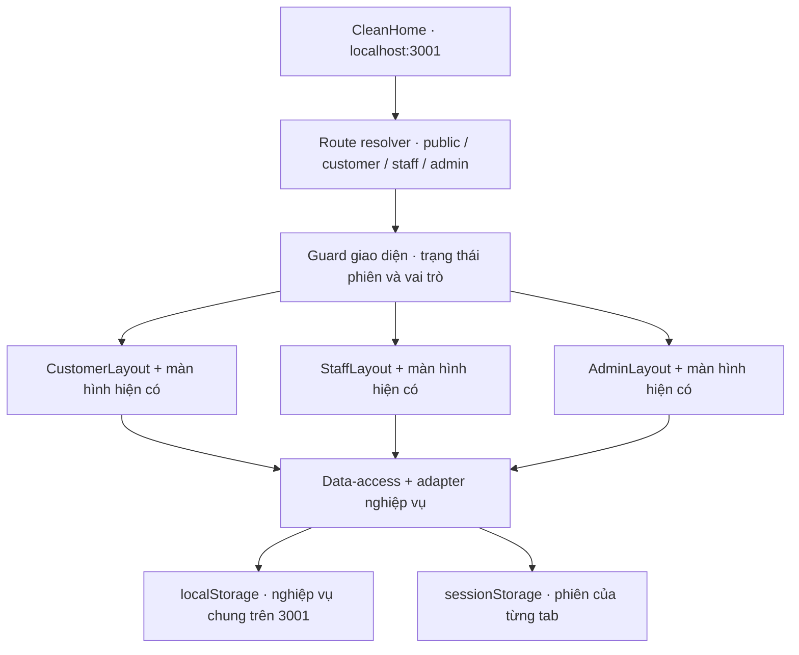

# CleanHome — Giai đoạn 4: hợp nhất frontend

> **Thay đổi chế độ chạy theo yêu cầu mới:** CleanHome được khôi phục thành ba website riêng: Customer `3001`, Staff `3002`, Admin `3003`. Customer không còn bắt buộc chọn dữ liệu; mỗi website dùng đăng nhập và kho dữ liệu riêng. Xem [hướng dẫn khôi phục ba website](THREE_WEBSITES_RESTORE.md) và [README hiện tại](../README.md). Nội dung, kết quả kiểm thử và hướng dẫn hợp nhất dưới đây là lịch sử Giai đoạn 4, không phải chế độ chạy mặc định hiện tại. Mã hợp nhất và dữ liệu của nó được giữ lại; không tự nhập hoặc xóa dữ liệu khi chuyển chế độ.

## Trạng thái triển khai 4.2–4.4

Người dùng đã phê duyệt hoàn thiện toàn bộ yêu cầu Giai đoạn 4, **không dừng giữa 4.2, 4.3 và 4.4**. Đã triển khai ứng dụng chung trên cổng **3001**, route Customer/Staff/Admin, đăng nhập và phiên dùng chung theo tab, guard quyền frontend, data-access, công cụ sao lưu/nhập/khôi phục. Hai ứng dụng Staff/Admin cũ vẫn được giữ nguyên điểm khởi chạy và chế độ riêng.

**Đã hoàn thành 4.1–4.4 trong phạm vi frontend.** Build production và typecheck Customer, Staff, Admin đều đạt. Đã kiểm tra trình duyệt các khu vực, luồng xuyên vai trò, migration, lỗi lưu và tương thích ứng dụng cũ. Những giới hạn chưa kiểm chứng được ghi riêng dưới đây.

Phương án phân tích 4.1 và kết quả lịch sử được giữ để đối chiếu. Các phần kiến trúc, migration và chạy website dưới đây đã cập nhật theo mã triển khai hiện tại.

Giai đoạn 4 theo yêu cầu mới **chỉ làm frontend**. Phần đề xuất API/database trong báo cáo 3B là định hướng tương lai, không phải công việc được triển khai trong giai đoạn này. Không xây backend/database, API server giả hoặc xác thực server. Đăng nhập, quyền và dữ liệu trình bày dưới đây đều là cơ chế thử nghiệm phía trình duyệt, không phải bảo mật production.

Giữ tên CleanHome, thư mục/repository, UI trắng sáng/xanh dương, các tính năng đã hoàn thiện, `frontend-legacy` và tất cả thay đổi Git chưa commit. Giữ hai ứng dụng Staff/Admin cũ cho đến khi kiểm thử đầy đủ và người dùng phê duyệt việc ngừng chúng.

Tài liệu đã đối chiếu: [Customer Giai đoạn 2](CUSTOMER_UI_PHASE2.md), [Staff Giai đoạn 3A](STAFF_UI_PHASE3.md), [Admin Giai đoạn 3B](ADMIN_UI_PHASE3.md), các app wrapper/config, Portal, layout/navigation, core/store/auth và các adapter liên quan.

## Hiện trạng tại thời điểm phân tích 4.1

Bảng sau là hiện trạng **trước khi triển khai 4.2–4.3**, không phải trạng thái của website chung hiện tại.

| Khu vực | Hiện trạng | Ảnh hưởng khi hợp nhất |
| --- | --- | --- |
| Ứng dụng | `apps/customer`, `apps/staff`, `apps/admin`, cùng Next.js 16.3.6/React/TypeScript | Có thể dùng Customer làm app chính, không sao chép toàn bộ màn hình |
| Cổng | Customer 3001; Staff 3002; Admin 3003; scripts riêng trong workspace | Website chung dùng 3001, app cũ vẫn giữ cổng/scripts hiện có |
| Route | Mỗi app có `app/[[...slug]]/page.tsx`, `await params`, truyền role cố định và path vào `Portal` | Cần route riêng `/staff`, `/admin` và tách khu vực URL khỏi quyền tài khoản |
| Package | Cùng alias tới `packages/ui/src` và `packages/core/src` | Tái sử dụng component, hook và nghiệp vụ; thay các điểm phụ thuộc mode/role |
| Cấu hình | `NEXT_PUBLIC_APP_ROLE` cố định trong từng `next.config.mjs`; `APP_ROLE` đọc từ cấu hình build | Không thể chỉ thêm route Admin vào Customer rồi giữ nguyên auth/action |
| Dữ liệu | `AppState` v2 chứa users, services, orders, payments, reviews, passwordHashes và session | Đủ model cho luồng chung; tách lưu nghiệp vụ khỏi phiên, giữ shape snapshot cho UI |
| Lưu trữ | `cleanhome-demo-state-customer`, `cleanhome-demo-state-staff`, `cleanhome-demo-state-admin` | Khóa phụ thuộc role; localStorage còn tách theo origin/port |
| Store | Cache module, `useSyncExternalStore`, listeners trong tab và `storage` giữa tab cùng origin | Có nền cho dữ liệu chung; chưa có đồng bộ giữa origin/thiết bị |
| Load | Thiếu key, JSON lỗi hoặc version khác 2 đều có thể khởi tạo seed rồi persist | Loader mới phải phân biệt thiếu/lỗi/phiên bản không hỗ trợ; không ghi đè dữ liệu lỗi |
| Save | Store giữ RAM khi ghi localStorage thất bại; tám adapter đối chiếu dữ liệu để báo local/session | Data-access mới phải trả kết quả lưu thật, giữ thông báo lỗi hoặc chỉ lưu trong phiên |
| Auth | Login kiểm email/mã băm, tài khoản active và role bằng `APP_ROLE` | Login chung cần xác thực tài khoản rồi lấy role từ User, không từ URL/email/build |
| Phiên | Hiện nằm trong JSON nghiệp vụ; `useCurrentUser` chưa kiểm role phiên trùng role User | Cần schema phiên và guard thống nhất; khóa/xóa tài khoản phải làm phiên mất hiệu lực trong UI |
| Quyền action | Admin actor/adminOnly và một số adapter kiểm `APP_ROLE`; Customer/Staff chưa thống nhất mọi kiểm tra actor active-role | Chuẩn hóa actor trong mode chung, giữ ownership và điều kiện nghiệp vụ hiện có |
| Đăng ký/cấp tài khoản | Register chỉ tạo Customer; Admin cấp Customer/Staff, chưa có action tạo Admin mới | Giữ Admin hiện có, không quảng cáo có luồng cấp Admin mới |
| Mật khẩu | Đăng ký lưu mã băm thay plaintext; hàm băm hiện tại là mô phỏng 32-bit | Giữ tương thích tài khoản thử nghiệm, không coi là cơ chế mật khẩu production |
| API | `core/src/api-client.ts` là helper dự phòng, UI chưa dùng để lấy dữ liệu | Chỉ chuẩn hóa interface frontend; không tạo endpoint hoặc tuyên bố đã nối API |

CustomerAuth và StaffLogin đã có validation, PasswordField, loading/focus và chống gửi trùng. InternalAuth Admin còn khối tài khoản trải nghiệm công khai; website chung cần dùng form chung không chứa khối này. Không đưa email/mật khẩu tài khoản thử nghiệm hoặc giá trị mã băm vào tài liệu/giao diện đăng nhập chung.

Các action cần bảo toàn gồm đặt lịch, yêu cầu/duyệt hủy, sửa lịch, phân công và kiểm tra trùng lịch, tiếp nhận/bắt đầu/hoàn thành, ghi chú, thanh toán, đánh giá, hồ sơ, tài khoản, dịch vụ và CSV. Bổ sung guard actor phục vụ yêu cầu phân quyền frontend; không thay công thức giá, thời lượng, lịch, trạng thái hoặc ý nghĩa paid/refundRequired.

## Kiến trúc đã triển khai

Chọn **`apps/customer` làm ứng dụng chính tại `http://localhost:3001`**, giữ tên workspace/thư mục. Giữ một root layout, font Be Vietnam Pro, Toaster, Customer base theme và `portal.css`. Dùng lại CustomerLayout, StaffLayout, AdminLayout và tất cả màn hình đã có.



### Route và layout

Giữ Customer catch-all; đã thêm `apps/customer/app/staff/[[...slug]]/page.tsx` và `apps/customer/app/admin/[[...slug]]/page.tsx`. Các wrapper truyền khu vực và path tương đối vào Portal; `params` được await theo Next.js đang cài. Portal chọn layout từng khu vực nên không bọc StaffLayout/AdminLayout thêm lần nữa trong Next wrapper.

Khu vực route quyết định màn hình; **User active của phiên quyết định quyền**. `AreaRoutesProvider`, `AreaLink`, `areaHref` và `useAreaRoutes` áp dụng basePath `''`, `/staff`, `/admin` trong mode chung; app Staff/Admin cũ dùng basePath `''`. Link, logo, active state, nút quay lại và điều hướng sau thao tác được nối qua helper. Không viết lại DOM để sửa URL.

Matcher kiểm đủ số segment và ID/slug; route không hợp lệ có trang không tìm thấy. `/admin/dich-vu` không được rơi về catalog Customer. Route group chỉ tổ chức file, không tự tạo prefix URL; chưa cần chuyển toàn bộ catch-all sang cây route chi tiết trong bước đầu.

### Bảng ánh xạ bảo toàn

Tất cả URL mới dưới origin 3001. URL cũ trên 3002/3003 vẫn tồn tại khi giữ các app cũ; không giả định redirect giữa cổng mang theo phiên.

| App/cổng hiện tại | Route hiện tại | Route website chung |
| --- | --- | --- |
| Customer 3001 | `/` | `/` |
| Customer 3001 | `/dich-vu` | `/dich-vu` |
| Customer 3001 | `/dich-vu/:slug` | `/dich-vu/:slug` |
| Customer 3001 | `/dat-dich-vu` | `/dat-dich-vu` |
| Customer 3001 | `/dat-dich-vu/:id` | `/dat-dich-vu/:id` |
| Customer 3001 | `/don-cua-toi` | `/don-cua-toi` |
| Customer 3001 | `/don/:id` | `/don/:id` |
| Customer 3001 | `/lich-su` | `/lich-su` |
| Customer 3001 | `/ho-so` | `/ho-so` |
| Staff 3002 | `/` | `/staff` |
| Staff 3002 | `/cong-viec` | `/staff/cong-viec` |
| Staff 3002 | `/don/:id` | `/staff/don/:id` |
| Staff 3002 | `/lich-lam-viec` | `/staff/lich-lam-viec` |
| Staff 3002 | `/ho-so` | `/staff/ho-so` |
| Admin 3003 | `/` | `/admin` |
| Admin 3003 | `/don-dich-vu` | `/admin/don-dich-vu` |
| Admin 3003 | `/don/:id` | `/admin/don/:id` |
| Admin 3003 | `/phan-cong` | `/admin/phan-cong` |
| Admin 3003 | `/lich-lam-viec` | `/admin/lich-lam-viec` |
| Admin 3003 | `/tai-khoan` | `/admin/tai-khoan` |
| Admin 3003 | `/dich-vu` | `/admin/dich-vu` |
| Admin 3003 | `/thanh-toan` | `/admin/thanh-toan` |
| Admin 3003 | `/danh-gia` | `/admin/danh-gia` |
| Admin 3003 | `/bao-cao` | `/admin/bao-cao` |
| Admin 3003 | `/ho-so` | `/admin/ho-so` |
| Cả ba | `/dang-nhap` | `/dang-nhap` chung |
| Customer | `/dang-ky` | `/dang-ky`, chỉ tạo Customer |
| Cả ba | Chưa có công cụ xuất raw riêng | `/du-lieu`: website chung sao lưu/nhập; Staff/Admin cũ chỉ xuất raw tại cổng riêng |

Phải giữ thêm các route chi tiết/đặt lịch ngoài danh sách yêu cầu ban đầu. `:id` của `/dat-dich-vu/:id` hiện có thể là service ID hoặc order ID khi đặt lại; không đổi thành chỉ service ID. Customer thanh toán/đánh giá nằm trong dialog ở chi tiết đơn, không có route độc lập. Staff chưa có trang lịch sử/đánh giá riêng; không tự tạo hoặc bỏ chức năng để khớp URL.

`/staff/dang-nhap`, `/admin/dang-nhap` đưa về login chung; đích sau đăng nhập được chọn theo User và return path hợp lệ. `/staff/dang-ky`, `/admin/dang-ky` đưa về đăng ký chung, **chỉ tạo Customer**. Không mở đăng ký nhân viên/quản trị.

### Style và component tái sử dụng

- Giữ Customer globals làm base. Đã đưa các style Staff/Admin cần thiết và media query vào globals của app chính với scope `.staff-app`, `.admin-app`; không đổi root theme của hai app cũ.
- Logo đã nhận `href`: truyền `/staff` hoặc `/admin` ở app chung, giữ mặc định `/` trong app cũ. Header công khai đọc phiên chung để Staff/Admin thấy shortcut tới khu vực của mình; các trang Customer riêng vẫn có guard Customer.
- Footer Admin và các shortcut dùng helper theo mode: cùng origin ở website chung, giữ URL cổng riêng ở app cũ. Footer dùng Next Link để chuyển khu vực trên cùng website mà không tải lại document, giữ snapshot chưa lưu trong RAM. Không dùng các biến URL để đồng bộ phiên/dữ liệu.
- Tái sử dụng Button/Card/Input/Field/PasswordField/Logo/badge, skeleton/empty/error, Sheet/DropdownMenu và AdminDialog. Kiểm tra cả các menu render qua portal ra body sau đổi scope CSS.
- Đối chiếu **16 asset tương đối mỗi app, tổng 48 file**: hash giống hoàn toàn, không thiếu/khác. Customer `public` đủ dùng; không cần copy ảnh hoặc thêm thư viện.
- Giữ `devIndicators: false`, thiết lập ảnh và TypeScript hiện có. Admin profile vẫn dùng `manage.tsx::Profile`; bảo toàn và kiểm thử, chưa tự nâng cấp ngoài phạm vi hợp nhất.

## Store và phiên frontend chung

### Hợp đồng lưu trữ hiện tại

1. **Nghiệp vụ:** key mới `cleanhome-unified-state-v1`, trên origin 3001. Envelope `{schemaVersion: 1, revision, provenance, data}`; `data` giữ model v2 và luôn có `session: null`. Không tự đổi ID hoặc schema nghiệp vụ.
2. **Phiên:** key sessionStorage riêng `cleanhome-unified-session-v1`, envelope phiên có `schemaVersion: 1`. Một phiên dùng xuyên Customer/Staff/Admin trong mỗi tab; refresh cùng tab giữ phiên khi storage hoạt động. Có thể đăng nhập Customer, Admin, Staff ở ba tab, dùng chung nghiệp vụ. Không hứa tự đăng nhập lại sau khi đóng trình duyệt; hành vi khôi phục tab/phiên còn phụ thuộc trình duyệt.
3. **Snapshot UI:** store ghép dữ liệu nghiệp vụ và phiên hợp lệ của tab thành shape AppState cho các hook hiện có; Context UI truyền snapshot xuống các màn hình. Không lưu session của một tab vào payload nghiệp vụ chung. Dùng mode `unified` cho Customer chính và mode `legacy` cho Staff/Admin standalone; các key/mode cũ vẫn được bảo toàn.
4. **Data-access:** `DataAccess`/`browserDataAccess` cung cấp snapshot, subscription, command và persistence; local implementation dùng store chung. Tám adapter dùng `executeStoreCommand`, snapshot/persistence chung thay vì tự dựng key theo `APP_ROLE`. `useDataStatus` phân biệt loading/missing/ready/corrupt/unsupported/unavailable, revision, dirty và lỗi phiên. Lệnh trực tiếp trong Portal/Profile cũng đi qua điểm ghi chung.
5. **Sau này:** có thể cung cấp adapter API thật theo cùng interface khi được duyệt riêng. Không tạo route handler/API giả trong Giai đoạn 4. API tương lai phải trả dữ liệu theo quyền, không đưa nguyên AppState chứa registry mã băm xuống client như model thử nghiệm hiện tại.

sessionStorage được chọn để tránh một lần login/logout thay đổi tài khoản của mọi tab như khi session nằm chung localStorage. Dữ liệu nghiệp vụ cập nhật qua listeners/storage event trên cùng origin; storage event không gửi về tab ghi nên tab đó phải được thông báo trực tiếp. Không có đồng bộ giữa 3001/3002/3003, trình duyệt hoặc thiết bị.

### Tính nhất quán và lỗi lưu

- Trước mutation, đọc lại dữ liệu/revision và actor của tab; kiểm trạng thái/ownership/trùng lịch theo nghiệp vụ hiện có. Giá đơn đã lưu, amount thanh toán và nhận xét/số sao được giữ nguyên.
- Hàng đợi ghi dùng Web Locks theo origin, đọc lại state bên trong khóa `cleanhome-unified-write-v1`. Không có dependency mới. Revision riêng không tạo transaction/CAS cho localStorage; nếu không có Web Locks, chặn ghi nghiệp vụ và báo giới hạn.
- Loader mới phân biệt key thiếu, JSON sai, version không hỗ trợ và storage không đọc được. Dữ liệu sai được giữ nguyên raw, có error/recovery state và khóa ghi; không tự fallback seed, sửa hoặc reset.
- Khi key mới chưa tồn tại, cần chọn/xem lại nguồn trước khi ghi. Không tự copy Customer, ưu tiên Admin hoặc khởi tạo seed vào key chung. Nếu người dùng muốn bộ dữ liệu thử mới, đó là lựa chọn khởi tạo riêng cần xác nhận; không xóa key cũ.
- Quota/blocked storage trả kết quả thật. Nếu chỉ giữ trong RAM, thông báo giới hạn phiên và không báo lưu máy chủ; không để tab khác tưởng đã nhận thay đổi không persist được. Lỗi ghi không tự bỏ ảnh đại diện hay bản ghi để giảm dung lượng.
- Bản RAM chưa lưu có cờ dirty và revision nguồn. Storage event từ tab khác không được tự thay snapshot này rồi làm mất thay đổi; báo xung đột, khóa ghi tiếp theo và giữ bản chưa lưu để xem lại/xuất trước khi người dùng chọn cách xử lý. Không gọi trạng thái RAM này là đã đồng bộ.
- `/du-lieu` có nút sao lưu **bản đang giữ trong tab** riêng với bản đã persist. Tài khoản đang hoạt động có thể sao lưu bản dirty của mình; tải lại cần file sao lưu đúng snapshot hiện tại và checkbox xác nhận. Không tự gọi `reloadUnifiedData` làm mất bản chưa lưu.
- Phiên lỗi, User biến mất/bị khóa hoặc role phiên khác User làm UI trở về chưa đăng nhập/không có quyền; dữ liệu nghiệp vụ không bị xóa. Lỗi sessionStorage không được báo đã giữ phiên qua refresh.
- Logout xóa phiên tab và cache auth, không xóa nghiệp vụ hay key cũ. Nếu không xóa được sessionStorage, chặn phiên trong RAM và báo lỗi; cần kiểm thử refresh để không hứa thu hồi phiên đã lưu khi browser từ chối thao tác. Đây vẫn không phải cơ chế thu hồi phiên server.

## Đăng nhập, đăng ký và role guard

Tái sử dụng form CustomerAuth/PasswordField/validation thay vì viết lại UI. Login không có chọn role: kiểm email/mật khẩu bằng registry thử nghiệm hiện có, kiểm User active, lấy role đã xác thực rồi tạo phiên tab. Không trim mật khẩu, không persist plaintext, không dùng phần tên email hoặc query để suy ra quyền. Giữ loading, focus, mutex và lỗi cạnh trường; không hiện tài khoản thử nghiệm công khai.

Đích mặc định: Customer `/`, Staff `/staff`, Admin `/admin`. Nếu guard gửi return path, chỉ chấp nhận đường dẫn nội bộ đã chuẩn hóa, khớp route được hỗ trợ và đúng quyền; ưu tiên đích đó sau xác thực. Bỏ URL ngoài origin, protocol-relative, path sai hoặc khu vực khác role. Return path chỉ phục vụ điều hướng, không cấp quyền.

Register công khai luôn tạo Customer, kiểm họ tên/email/phone/password/confirm, email/phone trùng theo core hiện có và chống tạo lặp. Admin tiếp tục cấp Customer/Staff qua thao tác đã có; chưa tạo khả năng cấp Admin hoặc quên/đổi mật khẩu ngoài yêu cầu. Khi hydrate, dùng loading state trước khi quyết định chuyển route; không render dữ liệu riêng dựa vào một session chưa kiểm tra.

| Phiên của tab | Trang công khai + auth chung | Customer riêng | Staff riêng | Admin riêng |
| --- | --- | --- | --- | --- |
| Chưa đăng nhập | Được truy cập | Login kèm return path | Login kèm return path | Login kèm return path |
| Customer active | Được truy cập | Được truy cập, giữ ownership | Không có quyền | Không có quyền |
| Staff active | Được truy cập | Không có quyền | Được truy cập công việc của mình | Không có quyền |
| Admin active | Được truy cập | Không có quyền | Không có quyền | Được truy cập theo action hiện có |
| User thiếu/khóa, phiên sai cấu trúc/role | Chỉ nội dung công khai | Không mở dữ liệu riêng | Không mở dữ liệu riêng | Không mở dữ liệu riêng |

Người sai role có màn hình không có quyền và nút về đúng dashboard; không lặp login/redirect. Login/register khi đã có phiên hợp lệ điều hướng về khu vực tương ứng. Guard route và guard mutation cùng đọc actor active/role/ownership; URL không thay thế kiểm tra này. Người dùng vẫn có thể sửa dữ liệu/mã frontend bằng DevTools: đây chỉ là kiểm soát UI thử nghiệm.

## Migration: sao lưu, đối chiếu và xử lý xung đột

### Chứng cứ cùng ID có thể khác dữ liệu

Initializer được đối chiếu trong VM chỉ đọc nguồn, không dùng localStorage người dùng. Seed v2 có 15 users (8 Customer, 6 Staff, 1 Admin), 6 services, 26 orders, 13 payments và 6 reviews, không phụ thuộc APP_ROLE. Hai ngày khởi tạo 13/10 và 14/10 giữ cùng toàn bộ ID nhưng khác các trường sau:

| Collection | Khác giữa hai thời điểm khởi tạo |
| --- | --- |
| users | `createdAt` |
| orders | `code`, `scheduledAt`, `history`, `staffNotes`, `createdAt`, `cancelRequest` |
| payments | `createdAt`, `confirmedAt` |
| reviews | `createdAt` |
| services | Không khác trong phép đối chiếu seed này |

Các thay đổi thực tế còn có thể khác price/status/contact/assignment/payment/account/hash. **Chưa đọc hoặc so sánh bản ghi localStorage thật của người dùng**; không kết luận chúng giống seed hoặc nguồn Admin là đúng hơn.

### Công cụ đã triển khai

1. `/du-lieu` tại Staff/Admin cũ đọc raw trực tiếp, không mount Portal/store cũ và không gọi fallback seed. Website chung có nút xuất raw Customer cũ trên cùng origin và bản dữ liệu chung. File backup giữ riêng trên máy; có thông tin cá nhân/xác thực, không đưa vào repo, chat hoặc log.
2. Gắn metadata nguồn/origin/thời điểm/version/checksum cho snapshot; checksum để đối chiếu file, không phải chứng nhận bảo mật. 3001 chỉ nhận file người dùng chủ động xuất/nhập; không đọc trực tiếp storage của 3002/3003, dùng iframe hoặc API giả để làm đồng bộ.
3. Kiểm version/schema/enum/ngày/số, ID/email/code trùng và quan hệ user–service–order–payment–review. Record thiếu quan hệ được liệt kê, không tự tạo record bù hoặc xóa để làm sạch dữ liệu. Dữ liệu hỏng/không hỗ trợ phải có báo cáo trước khi chọn phương án phục hồi.
4. Người dùng chọn nguồn Customer đã sao lưu hoặc file từ các app cũ. Nếu key chung đã có dữ liệu hợp lệ, bản hiện tại được đưa vào đối chiếu sau khi sao lưu. Không tự ưu tiên nguồn nền; mọi bản khác cùng ID phải được chọn rõ ràng.
5. Cùng ID và toàn bộ payload nghiệp vụ giống nhau mới được gộp. Cùng ID nhưng khác payload đưa vào danh sách xung đột: hiển thị collection/ID/trường khác/nguồn; người dùng chọn bản ghi được giữ. Không ưu tiên role, timestamp mới nhất hoặc status cao nhất. Không ghép history, amount, price, lịch hoặc phân công ngầm.
6. User và `passwordHashes[userId]` phải đi cùng lựa chọn tương thích. Khác mã băm chỉ báo có xung đột xác thực, không hiển thị giá trị. Thiếu mã băm không tự cấp mật khẩu seed. Khác ID nhưng cùng email/code hoặc quan hệ mâu thuẫn cũng cần xử lý; không remap ID khi chưa có bảng ánh xạ được duyệt.
7. Xem lại toàn bộ bản nhập dự kiến và các quan hệ sau lựa chọn. Xung đột chưa giải quyết hoặc thiếu quan hệ bắt buộc chặn nhập; không âm thầm bỏ record. Không nhập session cũ vào phiên mới, không đăng nhập tự động. Session/key của app cũ giữ nguyên.
8. Chỉ sau xác nhận mới ghi **key mới**, dùng cùng khóa ghi theo origin như mutation. Kiểm lại revision/payload đích sau preview: nếu tab khác đã đổi dữ liệu, dừng nhập và yêu cầu xem lại. Nếu key chung đã có dữ liệu, backup và đối chiếu tiếp; không tự ghi đè. Đọc lại và đối chiếu checksum/count/quan hệ, báo đúng local/session hoặc lỗi; giữ nguồn/backup nguyên vẹn. Browser không có transaction cho nhiều key: lỗi phải giữ trạng thái không hoàn tất và cho khôi phục từ backup, không báo migration thành công giả.

Phê duyệt triển khai Giai đoạn 4 **không thay thế bước người dùng xem lại và xác nhận bản nhập thực tế**. Không đọc, reset hoặc nhập localStorage của người dùng trong quá trình phát triển/QA. Trong 4.1 chỉ có phân tích, chưa chạy migration.

Khi key chung đã hợp lệ, chỉ Admin active được dùng chức năng nhập/đối chiếu/sao lưu toàn bộ. Bootstrap khi thiếu key và khôi phục key không đọc được có luồng riêng vì chưa có phiên hợp lệ; khôi phục yêu cầu sao lưu raw đích trước rồi xác nhận rõ. File nhập tối đa 20 MB/file, dùng SHA-256 native Web Crypto. Checksum phát hiện nội dung file thay đổi, không chứng minh nguồn file đáng tin cậy.

Validator chặn ID/code/email/slug trùng, thiếu thông tin xác thực, quan hệ thiếu/sai role, đánh giá không khớp đơn và nhiều Payment/Review khác ID cùng một đơn. Không remap ID hoặc bỏ bản ghi để vượt validation. Với các xung đột không giải quyết được bằng chọn cùng ID, cần xem lại nguồn; công cụ không tự chỉnh dữ liệu nghiệp vụ.

Khi chưa có key chung, có thể **xem lại rồi xác nhận** bộ dữ liệu phát triển đã có trong dự án. Đây là lựa chọn chủ động riêng, không tự seed và không thêm dịch vụ/giá/đánh giá mới để làm đầy UI. Các nguồn nhập không mang theo phiên đăng nhập cũ.

## File triển khai Giai đoạn 4

Danh sách đối chiếu hash với snapshot trước chỉnh sửa `%TEMP%/cleanhome-phase4-implementation/source-before.json` (195 file), không dựa vào Git diff vì phần lớn frontend mới đang untracked từ các giai đoạn trước. Đối chiếu cuối: **156 file giữ nguyên, 39 file thay đổi, 12 file triển khai mới và hai file Next.js tự sinh; không mất file**. Đường dẫn dưới đây tính từ `frontend/`; **mới** nghĩa là tạo trong lượt triển khai này.

| Nhóm | File | Nội dung |
| --- | --- | --- |
| App chính | `apps/customer/next.config.mjs`<br>`apps/customer/app/globals.css` | Bật mode unified; đưa style Staff/Admin vào scope trên website chung |
| Wrapper mới | **Mới:** `apps/customer/app/staff/[[...slug]]/page.tsx`<br>`apps/customer/app/admin/[[...slug]]/page.tsx` | Khu vực Staff/Admin trong app Customer hiện có |
| Công cụ dữ liệu mới | **Mới:** `apps/customer/app/du-lieu/page.tsx`<br>`apps/staff/app/du-lieu/page.tsx`<br>`apps/admin/app/du-lieu/page.tsx` | Quản lý dữ liệu chung; Staff/Admin cũ xuất raw trực tiếp |
| Core | `packages/core/src/env.ts`<br>`packages/core/src/store.ts` | Mode unified/legacy, runtime actor, phiên tab, status, command và persistence |
| Core mới | **Mới:** `packages/core/src/data-access.ts`<br>`packages/core/src/unified-storage.ts`<br>`packages/core/src/data-migration.ts` | Interface dữ liệu, envelope/locks/revision, validator/backup/checksum/merge |
| Route và dữ liệu UI mới | **Mới:** `packages/ui/src/components/shared/area-routes.tsx`<br>`packages/ui/src/components/shared/route-policy.ts`<br>`packages/ui/src/components/shared/data-setup.tsx`<br>`packages/ui/src/components/shared/data-export.tsx` | Prefix URL, return-path policy, bootstrap/import/recovery, sao lưu raw và RAM |
| Portal và common | `packages/ui/src/portal.tsx`<br>`packages/ui/src/common.tsx`<br>`packages/ui/src/manage.tsx` | Resolver/guard/auth chung, link theo khu vực, async command cho các action trực tiếp và profile cũ |
| Customer UI | `packages/ui/src/components/customer/customer-auth.tsx`<br>`packages/ui/src/components/customer/customer-profile.tsx`<br>`packages/ui/src/components/customer/site-header.tsx`<br>`packages/ui/src/components/customer/site-footer.tsx` | Đăng nhập/đăng ký chung, shortcut theo role, dữ liệu hồ sơ, liên kết đúng origin |
| Customer adapter | `packages/ui/src/components/customer/account-service.ts`<br>`packages/ui/src/components/customer/booking-service.ts` | Actor/session chung, command/persistence; giữ đặt lịch và công thức cũ |
| Staff UI/navigation | `packages/ui/src/components/staff/staff-layout.tsx`<br>`staff-dashboard.tsx`<br>`staff-jobs.tsx`<br>`staff-calendar.tsx`<br>`staff-shared.tsx`<br>`staff-job-detail.tsx`<br>`staff-profile.tsx` | Các file rút gọn cùng thư mục `components/staff/`; prefix link/logo/active/back, giữ màn hình hiện có |
| Staff adapter | `packages/ui/src/components/staff/staff-job-service.ts`<br>`packages/ui/src/components/staff/staff-profile-service.ts` | Data-access chung; quyền sở hữu công việc, trạng thái, hồ sơ và stale guard |
| Admin UI/navigation | `packages/ui/src/components/admin/admin-layout.tsx`<br>`admin-dashboard.tsx`<br>`admin-orders.tsx`<br>`admin-order-detail.tsx`<br>`admin-assignment.tsx`<br>`admin-calendar.tsx`<br>`admin-accounts.tsx`<br>`admin-services.tsx`<br>`admin-payments.tsx`<br>`admin-reviews.tsx`<br>`admin-reports.tsx` | Các file rút gọn cùng thư mục `components/admin/`; prefix link/dialog/đơn liên quan, async confirmation khi cần |
| Admin adapter | `packages/ui/src/components/admin/admin-order-service.ts`<br>`packages/ui/src/components/admin/admin-account-service.ts`<br>`packages/ui/src/components/admin/admin-service-service.ts`<br>`packages/ui/src/components/admin/admin-review-service.ts` | Runtime actor và điểm ghi chung; giữ các whitelist và điều kiện nghiệp vụ đã có |
| Tài liệu | `README.md`<br>`docs/FRONTEND_UNIFICATION_PHASE4.md` | Điểm chạy website chung, kiến trúc thực hiện, kiểm tra, migration và giới hạn |

Next.js tự sinh thêm `apps/customer/AGENTS.md`, `apps/customer/CLAUDE.md`. `apps/customer/next-env.d.ts` cũng có thể được công cụ cập nhật theo types development/build và cần đối chiếu lại ở lượt cuối. File công cụ sinh được ghi riêng với các chỉnh sửa triển khai; không sửa thủ công `node_modules`, `.next`, `dist` hoặc output build.

Không đổi tên app/repository, copy asset hoặc thêm dependency. Backend/database và frontend-legacy không chỉnh sửa. Gian hàng, giỏ hàng, đơn mua, tồn kho giữ nguyên để chuyển theo kế hoạch riêng; hợp nhất frontend dịch vụ không đồng nghĩa đã chuyển các chức năng đó.

## Rủi ro chính và cách xử lý

| Rủi ro | Cách xử lý đề xuất |
| --- | --- |
| Giữ APP_ROLE Customer khiến login/action Staff/Admin bị chặn | Mode bootstrap riêng; area chỉ chọn UI, actor lấy từ User đã xác thực |
| Same-ID merge làm mất giá/lịch/lịch sử hoặc ghép nhầm thanh toán | Backup raw, so toàn payload, chọn xung đột và kiểm lại quan hệ |
| Loader cũ tự seed thay dữ liệu JSON/version lỗi | Không dùng loader đó để migration; loader key mới chỉ báo lỗi và khóa ghi |
| Link root-relative hoặc SITE_URLS mở sai app | Route helper/context; kiểm tất cả CTA/sidebar/dialog/back/logo trên cả main và legacy |
| Theme/root CSS ghi đè nhau hoặc portal menu mất style | Một base theme; scope Staff/Admin; đo cả menu/dialog ở bốn chiều rộng |
| Session role sai, tài khoản khóa hoặc mất khi refresh/logout quota | Phiên tab có schema/active-role guard; kiểm storage thật và báo lỗi, không xóa nghiệp vụ |
| Hai tab ghi đè nhau hoặc form giữ bản ghi cũ | Khóa ghi theo origin, đọc lại revision/actor/rules; lỗi stale giữ draft để xem lại |
| LocalStorage được hiểu là backend hoặc bảo mật production | Tài liệu nêu giới hạn; không tạo API giả, số liệu/giao dịch/hoàn tiền giả |

## Tiến độ 4.2–4.4 và điều kiện kiểm chứng

| Bước | Công việc | Điều kiện kiểm tra |
| --- | --- | --- |
| **4.2 — Hoàn thành** | Wrapper/route helper, mode/data-access, CSS scoped và công cụ migration; giữ app cũ | Build/typecheck cả ba app; route và bố cục trên ứng dụng chung đã đạt |
| **4.3 — Hoàn thành** | Login/register chung, runtime actor/role guard, session tab, nối adapter; xử lý lỗi lưu/dirty RAM | Đăng nhập/đăng ký, quyền, phiên, luồng xuyên vai trò và hồi quy core đã đạt |
| **4.4 — Hoàn thành** | Route/action, responsive, navigation/refresh/lỗi lưu, migration, app cũ và tài liệu | Các lượt QA hoàn tất có báo cáo đạt; giới hạn nằm ở phần riêng |

4.2 và 4.3 có phụ thuộc: route chung cần mode tương thích, còn login/action đầy đủ cần runtime actor và phiên chung. Không đánh dấu luồng Customer → Admin → Staff hoàn thành chỉ vì route mở được. Theo chỉ đạo mới, tiếp tục hoàn thiện toàn bộ Giai đoạn 4 và chỉ dừng khi kết thúc, không tự triển khai backend hoặc giai đoạn sau.

Checklist 4.4 cần đối chiếu với báo cáo kiểm tra thực tế:

- Kiểm toàn bộ bảng URL, direct URL/refresh/unknown route, return path ngoài origin hoặc sai role; các alias auth và ID không tồn tại. Kiểm cả app Staff/Admin standalone vì dùng chung core/UI.
- Bốn chiều rộng **375, 390, 768, 1440px**: Header/sidebar/footer, bảng/card, form, dialog, menu portal; không tràn/cắt hoặc dùng overflow-x hidden che lỗi; ảnh/focus/bàn phím/loading/empty/error.
- Guest, Customer, Staff, Admin; tài khoản thiếu/khóa, session lỗi/sai role, đổi account trong tab, đóng tab và refresh; đăng ký trùng/role injection, gửi nhiều lần, hiện/ẩn mật khẩu, logout khi storage lỗi.
- Trên profile QA riêng: Customer tạo yêu cầu → Admin xác nhận/phân công → Staff tiếp nhận/bắt đầu/hoàn thành → Customer/Admin thấy trạng thái. Kiểm cùng tab đổi tài khoản và ba tab cùng origin, chặn sở hữu sai/trùng lịch/chuyển trạng thái không hợp lệ; giữ giá và chỉ thêm một lịch sử khi gửi trùng.
- Thanh toán/review/hủy/hồ sơ/account/service/CSV/báo cáo giữ nghiệp vụ hiện có; doanh thu paid-only theo ngày xác nhận hoặc ngày tạo bản ghi như Dashboard, không coi refundRequired là đã hoàn.
- JSON/version lỗi, storage bị chặn/quota, key thiếu, import same-ID/conflict/orphan/hash/account khác, import vào key chung đã có dữ liệu, lỗi giữa chừng và stale form/multi-tab. Đối chiếu nguồn/backup sau kiểm tra; không reset dữ liệu người dùng.
- Mỗi lệnh CDP tối đa khoảng 20 giây; mỗi lượt browser khoảng 180–240 giây, có cleanup và đối chiếu phục hồi dữ liệu. Không Chrome headless hoặc tiến trình QA vô hạn. Chỉ chạy profile riêng và server cần thiết.

## Kết quả lịch sử của Bước 4.1

- Đã đọc AGENTS và các báo cáo Customer/Staff/Admin; kiểm Git status và khảo sát app/package/route/layout/core/auth/adapters liên quan.
- Đã đối chiếu route, CSS/asset, các điểm phụ thuộc cổng/APP_ROLE/key, initializer cùng ID khác dữ liệu; hoàn thiện phương án và kế hoạch ở tài liệu này.
- **File thay đổi duy nhất:** `frontend/docs/FRONTEND_UNIFICATION_PHASE4.md`. Nguồn frontend/ba báo cáo trước giữ nguyên; không di chuyển hoặc sửa code/config, backend/database/legacy, dữ liệu trình duyệt hoặc dependency. Không commit/push/merge/đổi nhánh.
- Kiểm tra bảo toàn bằng hash của **189 file hiện có trong apps/packages/docs** và Git status trước/sau; kiểm khoảng trắng và đường dẫn tài liệu. Đây là kiểm tra nguồn/tài liệu, không phải QA website hợp nhất.
- **Không chạy lại typecheck/build/browser trong 4.1** vì chỉ thêm tài liệu. Kết quả lịch sử 3B.3: build Admin và typecheck Customer/Staff/Admin đạt. Website chung, luồng cùng store, guard/session/migration/responsive mới **chưa được triển khai hoặc kiểm chứng**.
- Tại thời điểm 4.1 chưa đọc dữ liệu localStorage thật và chưa có thống kê xung đột của người dùng. Công cụ export/preview/import, key/session/data-access khi đó chỉ là đề xuất; đã được triển khai trong 4.2–4.3.

## Kết quả kiểm tra triển khai 4.2–4.4

Các kết quả dưới đây thuộc lượt triển khai hiện tại, không dùng kết quả 3B để kết luận website chung đã hoạt động.

- **Core: 88 kiểm tra VM đạt**, dùng core thật và storage độc lập cho nghiệp vụ/auth/session/runtime actor/persistence. Bổ sung kiểm tra identity snapshot ổn định và giữ bản chưa lưu khi tab khác cập nhật. Không log thông tin xác thực. Script `%TEMP%/cleanhome-unified-core-regression.cjs`.
- **Migration: 58 assertions đạt**, gồm seed hiện có hợp lệ; enum/ngày/số/ID/code/email/hash/quan hệ lỗi; duplicate toàn bản ghi; xung đột history và xác thực; lựa chọn User/hash cùng nguồn; không nhập session; checksum và raw lỗi; stale/concurrent commit chỉ một lần thắng; quota/Web Locks; bảo toàn ba key cũ và khôi phục có chủ ý. Script `%TEMP%/cleanhome-unified-migration-check.cjs`.
- **Navigation: 68 kiểm tra helper đạt** cho mode unified/legacy; **route policy: 160 assertions đạt**; **đơn/lịch: 9 kiểm tra đạt**. Đây là kiểm tra logic và source, chưa thay thế browser.
- **Build production và typecheck Customer, Staff, Admin đều đạt.** Chạy tuần tự để tránh cạnh tranh tài nguyên/types. Sau chỉnh sửa cuối của màn hình dữ liệu/Footer, đã build lại Customer và Admin, typecheck lại cả ba app. Không thêm dependency hoặc bỏ qua lỗi TypeScript.
- **Bootstrap và luồng nghiệp vụ: 30 kiểm tra, 56 lượt bố cục đạt.** Thiếu key không tự seed; xem trước không ghi; xác nhận khởi tạo có checkbox. Customer đặt lịch với dịch vụ đã chọn → Admin xác nhận/phân công → Staff tiếp nhận/bắt đầu/hoàn thành/ghi chú → Customer/Admin thấy cập nhật cùng origin. Chọn chuyển khoản vẫn pending cho đến khi Admin ghi nhận; đánh giá dùng action thật phía trình duyệt. Giữ giá đơn, một bản ghi thanh toán, đặt lại đúng dịch vụ/số lượng. Doanh thu Dashboard và báo cáo đối chiếu đúng các khoản paid; file CSV tải được và có nội dung báo cáo.
- **Điều hướng: 115 kiểm tra trình duyệt, 136 lượt bố cục đạt.** Gồm trang công khai, toàn bộ route Customer/Staff/Admin, chi tiết/đặt lại, phiên độc lập giữa tab, refresh/logout, ownership, ID thiếu, route sai, return URL, Header/Footer, menu mobile/Escape/focus/resize và sidebar thu gọn. Các báo cáo cuối `public-report`, `customer-report`, `staff-full-report`, `admin-full-report`, `session-full-report` đều đạt.
- **Authentication: 64 kiểm tra trình duyệt đạt.** Đích mặc định ba vai trò; next đúng quyền; chặn next ngoài origin/sai vai trò; phiên thiếu/sai/khóa; validation, loading, hiện/ẩn mật khẩu, trùng email/phone và gửi lặp. Đăng ký một tài khoản QA bằng mật khẩu ngẫu nhiên, chỉ tạo Customer kể cả email có tiền tố khác; không có plaintext trong dữ liệu lưu.
- **Quản trị có ghi dữ liệu: 28 kiểm tra trình duyệt đạt.** Tạo/sửa/ngừng/mở lại dịch vụ QA, sửa/khóa/mở Customer QA, thêm Staff QA, lưu hồ sơ Admin. Hai tab kiểm chứng stale form dịch vụ/tài khoản/hồ sơ bị chặn và giữ draft. Đơn, giá đơn và dịch vụ đã có giữ nguyên; địa chỉ Admin phục hồi qua UI.
- **Migration: 94 kiểm tra trình duyệt, 28 lượt bố cục đạt.** Backup raw/checksum, nhập/xung đột User cùng hash, bảo toàn nguồn và giá/lịch, quyền Admin, khôi phục dữ liệu hỏng, JSON/quan hệ/file quá lớn, storage đọc lỗi/quota, Web Locks thiếu hoặc chờ khóa, concurrent target và dữ liệu rỗng. Dirty RAM có backup riêng; remote revision không làm mất bản chưa lưu; sửa tiếp bị chặn; tải lại cần backup đúng snapshot và checkbox. Tất cả suite khôi phục chính xác dữ liệu QA (`dataRestored: true`).
- **Staff/Admin cũ: 44 kiểm tra chức năng, 24 lượt bố cục đạt.** Mỗi `/du-lieu` không mount loader/seed khi key thiếu/hỏng; tải raw/checksum/source đúng, login đúng vai trò, chặn vai trò khác, dashboard/route/chi tiết/logout và link không có prefix. Không tạo unified key ở cổng cũ; local/session keys phục hồi nguyên vẹn. Hai server kiểm thử 3002/3003 đã dừng.
- **Chỉnh sửa cuối: 14 kiểm tra và tám lượt bố cục đạt.** Màn hình quản lý dữ liệu hướng dẫn đổi tài khoản đúng, giữ nguyên raw khi chỉ xem quyền. Footer Admin chuyển sang trang công khai bằng client navigation, giữ document và bản RAM sau lỗi quota; trang sao lưu vẫn đọc được bản chưa lưu. Fixture của lượt Footer đã phục hồi nguyên vẹn. Báo cáo `final-data-card-report.json` và `footer-dirty-navigation-report.json` trong thư mục QA chính.
- Responsive được đo tại **375, 390, 768 và 1440px**, đã xem ảnh mobile/desktop của các khu vực, dịch vụ, dialog, lỗi/empty và dữ liệu chưa lưu. Không ghi nhận tràn ngang hoặc nút ngoài vùng hiển thị trong các lượt hoàn tất; không thêm `overflow-x: hidden` để che lỗi. Không ghi nhận exception JavaScript trong các suite cuối.

Đã sửa lỗi React #185 do snapshot dirty được tạo lại sau mỗi lần đọc khi có revision mới từ tab khác. Store chỉ đổi object khi phiên thực sự đổi, giữ bản chưa lưu ổn định; cả kiểm tra identity VM và quota trên production mới đều đạt. Màn hình quyền quản lý dữ liệu cũng được làm rõ đường quay về khu vực hiện tại để đăng xuất trước khi đổi tài khoản.

Các lượt development/build song song ban đầu từng lỗi thiếu bộ nhớ Windows; đã dừng tiến trình QA riêng, chạy build tuần tự và kiểm tra lại thành công. Một số script ban đầu sai selector dialog/nhãn trạng thái hoặc bị toast che tọa độ click; đã sửa harness và chạy lại. Không tính các lượt lỗi hoặc báo cáo partial là kết quả đạt.

QA chỉ dùng VM/storage riêng và Chrome profile riêng, không đọc/reset localStorage của người dùng. Các lựa chọn bootstrap/import trong QA không phải nhập dữ liệu thật của người dùng. Lệnh CDP giới hạn 20 giây; suite thường 180–240 giây, lượt nhỏ 60–90 giây. Dữ liệu chung trong profile QA đã phục hồi đúng raw trước các thao tác kiểm thử; dữ liệu ở origin migration và hai app cũ cũng phục hồi theo báo cáo. Chrome QA đã đóng; ứng dụng chính production được giữ tại cổng 3001 để kiểm tra.

Artifact (ngoài Git): `%TEMP%/cleanhome-phase4-qa/` gồm bootstrap, lifecycle, navigation, auth, CSV và restoration; `%TEMP%/cleanhome-phase4-auth-qa/` gồm đăng ký và quản trị; `%TEMP%/cleanhome-phase4-migration-qa/` gồm import/recovery/errors/lock/quota và `migration-summary.json`; `%TEMP%/cleanhome-phase4-legacy-qa/{staff,admin}/report.json`; `%TEMP%/cleanhome-phase4-implementation/` gồm baseline và đối chiếu bảo toàn. File backup QA có thông tin xác thực, không đưa nội dung vào báo cáo hoặc Git.

## Giới hạn và công việc còn thiếu

- Đây là **prototype frontend**, toàn bộ dữ liệu nghiệp vụ và registry mã băm còn nằm trong trình duyệt. Role guard và Web Locks giúp kiểm soát luồng UI/ghi cùng origin; không ngăn người dùng sửa dữ liệu hoặc mã bằng DevTools, không thay thế xác thực/ủy quyền server.
- Hàm băm mật khẩu cũ vẫn được giữ để tương thích dữ liệu v2 và chưa đạt yêu cầu bảo mật production. File backup chứa thông tin cá nhân/xác thực; không công khai, không commit vào Git và chỉ nhập nguồn đáng tin cậy.
- Website chung đồng bộ business state giữa các tab **cùng origin 3001**; phiên riêng theo tab. Không tự đồng bộ với 3002/3003, trình duyệt khác hoặc thiết bị khác. Giữ key cũ, không tự coi dữ liệu Admin cũ là nguồn ưu tiên.
- Không có API quản trị/đặt lịch/xác thực mới, endpoint giả, backend/database thật hoặc giao dịch ngân hàng/hoàn tiền thật. `paid` là ghi nhận đã nhận tiền trên trình duyệt; `refundRequired` là cờ cần xử lý, chưa thực hiện hoàn tiền. Doanh thu vẫn paid-only theo định nghĩa Dashboard, chưa trừ khoản cần hoàn.
- Khi storage bị chặn/quota, thay đổi có thể chỉ còn trong RAM của tab. Cần tải file sao lưu bản chưa lưu trước khi tải lại; file backup không tự chứng minh đã persist hoặc đã đồng bộ sang tab khác.
- Kết quả chỉ áp dụng cho dữ liệu và các tình huống đã kiểm tra trên Chrome. Chưa kiểm chứng trình duyệt khác, thiết bị vật lý, server security hoặc tải lớn. Kiểm thử app cũ là hồi quy đăng nhập/điều hướng/xuất dữ liệu; không chạy lại toàn bộ tình huống nghiệp vụ cũ trên từng cổng.
- Admin profile tiếp tục dùng màn hình hiện có; hai app cũ vẫn giữ auth/storage legacy. Gian hàng, giỏ hàng, đơn mua và tồn kho trong frontend-legacy chưa chuyển sang Next.js, cần kế hoạch riêng để không mất chức năng.

## Mở và kiểm tra hiện tại

Từ thư mục `frontend` trong PowerShell, website chung chỉ cần lệnh Customer:

```powershell
npm.cmd run dev:customer
# http://localhost:3001 — Customer + /staff + /admin

# Chỉ chạy app cũ nếu cần kiểm tra hoặc xuất bản sao ở cổng riêng:
npm.cmd run dev:staff
# http://localhost:3002 — /, /cong-viec, /don/:id, /lich-lam-viec, /ho-so

npm.cmd run dev:admin
# http://localhost:3003 — các route Admin hiện có
```

Không mở tiến trình trùng cổng. Nếu server đã chạy, dùng server đó. Các route `/staff/...`, `/admin/...` đã được tạo trên cổng 3001; Staff/Admin cũ vẫn là nguồn dữ liệu riêng ở 3002/3003.

1. Mở `http://localhost:3001`. Nếu chưa có dữ liệu chung, chọn nguồn ở màn hình setup; không có tự khởi tạo hoặc tự copy dữ liệu cũ.
2. `/du-lieu`: tải file sao lưu Customer cũ; mở `http://localhost:3002/du-lieu` và `http://localhost:3003/du-lieu` để xuất nguồn ở từng cổng, rồi chọn các file trên website chung.
3. Xem counts/xung đột/quan hệ; chọn nguồn giữ cho từng xung đột, kiểm tra file tải xuống và checkbox xác nhận trước khi nhập. Nếu đã có target hợp lệ, đăng nhập Admin và sao lưu target trước. Nếu target lỗi, sao lưu raw rồi xem lại nguồn khôi phục.
4. `/dang-nhap` dùng một form cho ba vai trò, không chọn role. Đăng nhập bằng tài khoản thuộc nguồn đã chọn; `/dang-ky` luôn tạo Customer. Không đưa thông tin đăng nhập thử nghiệm vào tài liệu hoặc màn hình này.
5. Kiểm tra Customer `/dich-vu`, `/dat-dich-vu`, `/don-cua-toi`, `/lich-su`, `/ho-so`; Staff `/staff`, `/staff/cong-viec`, `/staff/lich-lam-viec`, `/staff/ho-so`; Admin `/admin` và toàn bộ bảng route ở trên.
6. Để xem đồng bộ xuyên vai trò, đăng nhập Customer/Staff/Admin ở các tab khác nhau trên **cùng origin 3001**. Đăng nhập ở cổng cũ không mang phiên/dữ liệu sang website chung.

Chạy build rồi typecheck của từng app tuần tự để tránh types được sinh lại trong lúc tsc đọc:

```powershell
npm.cmd run build:customer
npm.cmd run typecheck --workspace=@cleanhome/customer -- --incremental false
npm.cmd run build:staff
npm.cmd run typecheck --workspace=@cleanhome/staff -- --incremental false
npm.cmd run build:admin
npm.cmd run typecheck --workspace=@cleanhome/admin -- --incremental false
```

## Định hướng Giai đoạn 5 — chưa triển khai

Giai đoạn 4 không xây backend/database hoặc kiểm chứng API máy chủ. Bước tiếp theo cần đối chiếu mã backend hiện có rồi thiết kế và triển khai nguồn dữ liệu server thật theo phạm vi được phê duyệt riêng:

- Giữ một website Next.js hiện có với các khu vực Customer/Staff/Admin; thay local `DataAccess` bằng API adapter, DTO theo quyền và loading/error/persistence thật. Server lấy role từ tài khoản đã xác thực, kiểm RBAC và ownership ở mỗi endpoint; không tin role/client state/query.
- Xác thực server bằng session/cookie HttpOnly/Secure/SameSite phù hợp, băm mật khẩu an toàn trên server, logout/expiry/revocation, kiểm CSRF và giới hạn đăng nhập. Không gửi registry mã băm hoặc toàn bộ AppState xuống client.
- Database quan hệ cho tài khoản/quyền, dịch vụ, đơn và snapshot giá/phạm vi, lịch sử, phân công, payment/refund ledger, review/moderation và audit. Giá/lịch phải được server kiểm tra; phân công/xung đột/đổi trạng thái dùng transaction và kiểm đồng thời. Idempotency chặn tạo đơn/ghi nhận tiền lặp.
- Chỉ nối nhà cung cấp thanh toán và xử lý hoàn tiền thật khi được duyệt; webhook/đối soát được kiểm chứng trên server. Không đổi ý nghĩa `paid`/`refundRequired` bằng thao tác UI giả.
- Không tự nhập seed/localStorage vào database production. Cần xuất, đối chiếu, chọn dữ liệu có chủ ý, kiểm quan hệ và theo dõi kết quả nhập. Chuyển gian hàng/giỏ hàng/đơn mua/tồn kho theo kế hoạch riêng, giữ frontend-legacy đến khi kiểm tra đầy đủ.

Chưa ngừng/xóa Staff/Admin cũ, chưa triển khai Giai đoạn 5, chưa commit/push/merge hoặc đổi nhánh. Kết thúc Giai đoạn 4 phải báo kết quả thật và dừng để người dùng kiểm tra giao diện.
